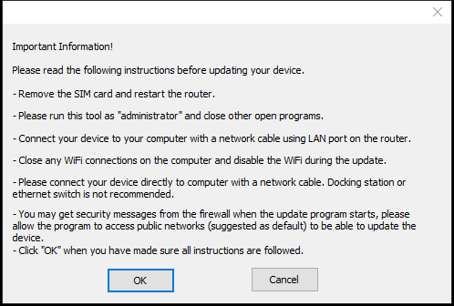
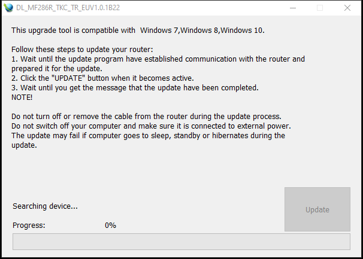

# ZTE MF286R One-Click OpenWrt Installer (23.05.6 & 25.12.6)

A standalone, **one-click Windows installer** that flashes permanent **OpenWrt** directly onto the **ZTE MF286R** LTE router over a standard Ethernet cable—**without requiring UART/Serial access, TFTP boot, or a two-step `initramfs` + `sysupgrade` workflow**.

---

## Key Features

- **Zero Disassembly / No UART Required:** Works directly over Ethernet from stock ZTE MF286R firmware (Turkcell Superbox, Türk Telekom Magnet, and other regional stock versions).
- **Direct Permanent Installation:** No need to flash an `initramfs` image first and manually run `sysupgrade`. When the installer reaches `100%`, the router boots straight into permanent OpenWrt.
- **Factory NVRAM & IMEI Preservation:** Keeps the router's factory calibration, MAC address, and IMEI data intact on flash.
- **Two Official OpenWrt Releases Available:**
  - **OpenWrt 23.05.6** (`Linux 5.15.189`, `ath79/nand`)
  - **OpenWrt 25.12.6 (Latest)** (`Linux 6.12.112`, `ath79/nand`)

---

## Download Installers (GitHub Releases)

Download the ready-to-use `.exe` installers from the [**Releases**](../../releases) page:

| OpenWrt Version | Installer File (in Releases) | Size | Target / Kernel |
| :--- | :--- | :--- | :--- |
| **OpenWrt 23.05.6** | `DL_MF286R_OPENWRT_23.05.6_compact.exe` | ~18.0 MB | `ath79/nand` (`Linux 5.15.189`) |
| **OpenWrt 25.12.6 (Latest)** | `DL_MF286R_OPENWRT_25.12.6_compact.exe` | ~19.0 MB | `ath79/nand` (`Linux 6.12.112`) |

---

## Screenshots

### Step 1: Pre-Update Instructions Dialog

### Step 2: Main Firmware Flashing Window

---

## Step-by-Step Installation Tutorial

1. **Prepare the Router:**
   - Remove the SIM card from the ZTE MF286R router and power it on.
   - Wait until the router finishes booting into its stock ZTE firmware (`192.168.0.1` or `192.168.1.1`, depending on your operator—check the label on the bottom of the device).
2. **Connect via Ethernet:**
   - Connect your computer directly to one of the **LAN ports** (LAN1, LAN2, or LAN3) on the router using an Ethernet cable.
   - Disable Wi-Fi on your computer during the flashing process.
3. **Run the OpenWrt Installer:**
   - Download either `DL_MF286R_OPENWRT_23.05.6_compact.exe` or `DL_MF286R_OPENWRT_25.12.6_compact.exe` from the [**Releases**](../../releases) section.
   - Right-click the `.exe` file and select **Run as administrator**.
   - Click **OK** on the *Important Information!* prompt.
4. **Flash OpenWrt:**
   - Wait a few seconds for the tool to detect the router (the **Update** button will become active).
   - Click **Update** and wait for the progress bar to reach **100% ("Upgrade successfully!")**.
   - Do **not** unplug the power or Ethernet cable while the update is in progress.
5. **Access OpenWrt (`192.168.1.1`):**
   - Once the installer finishes, the router will automatically reboot into OpenWrt.
   - Wait about **45–60 seconds** for the first boot initialization to complete.
   - Open your browser and navigate to **`http://192.168.1.1`** (or connect via SSH to `root@192.168.1.1`, no password by default).

---

## NVRAM-Safe NAND Partition Layout

| NAND Offset | Stock ZTE Partition | OpenWrt NVRAM-Safe Mapping | `root_uImage` Slice | Description |
| :--- | :--- | :--- | :--- | :--- |
| `0x001a0000 - 0x01000000` | `mtd6..mtd10` (`cfg-param`, `/zte_backup`) | *Unmapped (Protected)* | *Not touched* | **Preserves factory IMEI, Serial Number (`inica`), and NVRAM backups** |
| `0x01000000 - 0x01800000` | `mtd11` (`web`, `8 MiB`) | `ubiconcat0` (`8 MiB`) | `0x0000000 - 0x0800000` | UBI Layout Volume + `rootfs` (SquashFS) + free PEBs |
| `0x01800000 - 0x01b00000` | `mtd12` (`kernel`, `3 MiB`) | `kernel` (First `3 MiB`) | `0x0800000 - 0x0b00000` | OpenWrt Kernel `uImage` (`0x1800000..0x1c00000`) |
| `0x01b00000 - 0x01c00000` | `mtd13` (`rootfs`, First `1 MiB`) | `kernel` (Last `1 MiB`) | `0x0b00000 - 0x0c00000` | Remainder of `4 MiB` `kernel` partition |
| `0x01c00000 - 0x03500000` | `mtd13` (`rootfs`, Remaining `25 MiB`) | `ubiconcat1` (`25 MiB`) | `0x0c00000 - 0x2500000` | Erased (`0xFF`) PEBs auto-formatted by UBI as `rootfs_data` (`UBIFS` overlay) |

---

## Returning to Stock Firmware

If you ever wish to revert your ZTE MF286R from OpenWrt back to stock ZTE firmware over Ethernet/SSH (without UART), use our companion tool:
- [**zte-mf286r-openwrt-to-stock-restore**](https://github.com/laserbirdx/zte-mf286r-openwrt-to-stock-restore)

---

## License & Disclaimer

This project and its accompanying tutorial documentation are licensed under the [MIT License](LICENSE).

> **Disclaimer:** The MIT License applies to the documentation and scripts in this repository. OpenWrt is licensed under GPL-2.0. The firmware flashing wrapper utility is property of ZTE Corporation and is provided for interoperability/educational purposes only.
